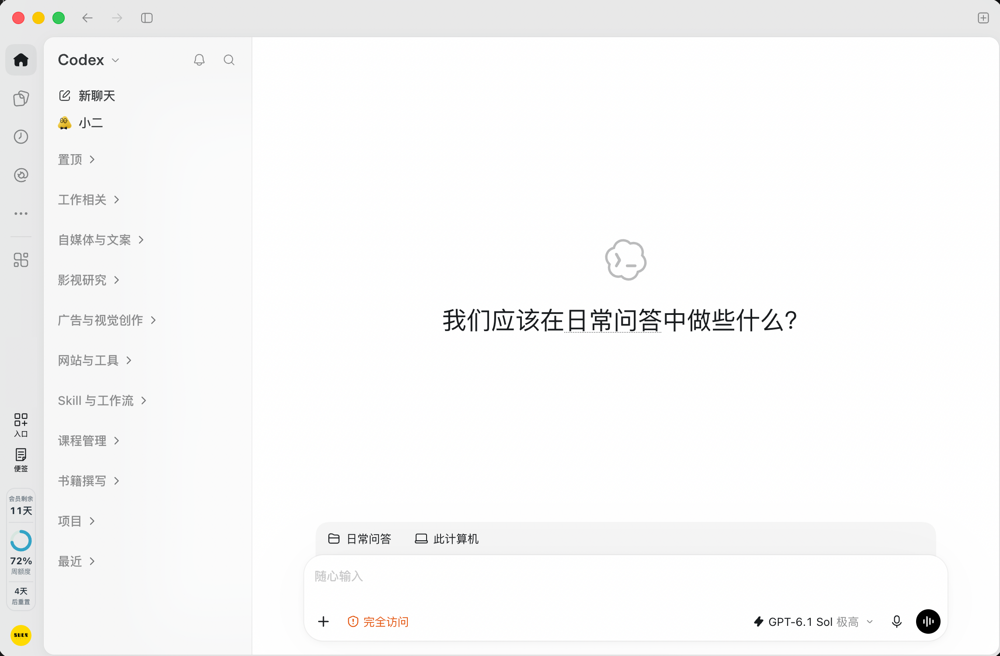

# Codex Sidebar Tools · Codex 侧栏工具栏

在 Codex 桌面客户端侧栏查看剩余额度、重置倒计时和手动记录的会员剩余天数，并使用快捷入口与本地便签。

**本插件参考原开源项目：[Lorie7813/codex-usage-card](https://github.com/Lorie7813/codex-usage-card)。**

原项目地址：https://github.com/Lorie7813/codex-usage-card



*上图为 macOS 界面示例，已获截图提供者授权用于介绍。天数与额度仅展示界面效果，不代表安装后的默认数值，也不是 Windows 实机截图。*

**当前版本：0.1.0-beta.2。** 非官方项目，与 OpenAI 无隶属或背书关系。提供 macOS 与 Windows 安装入口；Windows 桌面界面兼容性仍需带登录客户端的实机验证，详见[测试范围](docs/testing.md)。

## 功能

| 功能 | 用法 |
| --- | --- |
| 额度卡片 | 从本机 Codex CLI 的 app-server 读取账号额度；根据返回数据显示可用额度窗口。 |
| 重置倒计时 | 显示当前额度窗口距离重置还有多久，数据缺失或过期时不编造数值。 |
| 会员剩余天数 | 点击会员区域手动设置到期日，按北京时间的日期计算；续费后自行更新日期。 |
| 自定义快捷入口 | 在“入口”面板管理文件夹和网页；网页通过 Google Chrome 打开。 |
| 临时便签 | 自动保存在本机，切换聊天或重新打开客户端后可继续查看；多窗口编辑有冲突提示。 |
| 状态提醒 | 会员临近到期、额度偏低时以文字颜色提示。 |
| 更新后加载恢复 | 检测客户端更新和缺失的本机连接，保留当前工作窗口，等完全退出后尝试自动重新加载一次。 |

侧栏只保留 **“入口”“便签”** 两个工具按钮，不附带“课程”“工作”等固定按钮，也不附带作者的个人文件夹或便签。

额度详情只在鼠标停留于 **额度圆环、百分比和额度标签** 时显示；会员天数和重置倒计时不会触发该详情。会员日期是本地记录，**不是从账单自动读取的订阅到期日**。

## 使用前准备

- 已安装并登录原生 macOS 或 Windows 版 Codex／包含 Codex 的桌面客户端。
- 安装 [Node.js 24 或更新版本](https://nodejs.org/en/download)，在终端运行 `node --version` 确认可用。
- 客户端内置的 Codex CLI 可访问。安装器可探测常见安装位置，也支持手动指定。
- 网页入口需要已安装 Google Chrome。Windows 版使用原生 Windows 环境，不使用 WSL 的 Node 或账号目录。

Windows 原生客户端与 WSL 的账号／配置目录区别可参考 [OpenAI 的 Windows 桌面应用说明](https://learn.chatgpt.com/docs/windows/windows-app)；该说明不代表官方支持本插件的内部侧栏集成。

本项目通过 **`127.0.0.1:39223` 的本机调试接口** 显示侧栏组件。该接口没有因为绑定 localhost 就自动获得身份认证，本机其他程序可能访问客户端窗口；不要转发或公开端口。完整影响见[安全说明](SECURITY.md)。

## 下载与安装

从 [Releases](https://github.com/youngerweb2026/codex-sidebar-tools/releases) 下载对应系统的 ZIP 和 `SHA256SUMS.txt`，核对 SHA-256 后完整解压。自动生成的 GitHub “Source code” 归档适合查看源码；平台 ZIP 内附对应系统的入口脚本。

| 系统 | 双击入口 | 详细步骤 |
| --- | --- | --- |
| macOS | `scripts/安装.command`，随后 `scripts/打开Codex.command` | [macOS 安装说明](docs/macos.md) |
| Windows | `scripts/安装.cmd`，随后 `scripts/打开Codex.cmd` | [Windows 安装说明](docs/windows.md) |

也可在解压后的项目目录用终端执行：

```sh
node manage.cjs install
node manage.cjs launch
```

**首次启动前请自行保存工作并完全退出桌面客户端。** 如果客户端已在运行且没有启用本项目需要的调试端口，启动器会提示你手动处理；也可使用“恢复插件”入口安排退出后恢复。它不会强行关闭工作窗口。

首次启动推荐使用本项目提供的 **“打开Codex”** 入口，以直接携带正确参数。本项目不修改应用包或其签名。

### 客户端更新后

0.1.0-beta.2 增加 macOS 与 Windows 的启动恢复：后台检测应用替换、安装位置变化和未开启本机连接的客户端，并重新查找当前版本的内置 CLI。如果窗口正在使用，就记录恢复待办，等你完全退出后再带正确参数打开一次；不会中断正在工作的窗口。没有待处理恢复时，正常退出后保持关闭。

如果更新后卡片仍未出现，先保存工作并完全退出，等待约 10 秒。也可双击 `scripts/恢复插件.command`（macOS）或 `scripts/恢复插件.cmd`（Windows），或运行：

```sh
node manage.cjs recover
```

恢复依赖本项目后台仍在运行。若 Windows 登录启动项不可用，先运行“恢复插件”或“打开Codex”入口。恢复处理启动参数与路径变化；未来客户端若大幅修改内部界面或协议，仍可能需要进一步适配。

### 升级本项目

从 Releases 下载新平台 ZIP，完整解压后重新运行“安装”，即可更新本项目程序并保留 `data/state.json` 中的会员日期、便签和快捷入口。建议先备份该文件；不要先卸载或删除数据目录。升级不要求结束当前工作窗口，按提示完成一次退出后恢复即可。插件不会自动下载或安装自身更新。

### 已安装旧版的用户

这是一个独立项目，使用独立目录、任务名称和端口。安装与卸载只处理本项目所属文件，**不会自动停用、卸载或覆盖旧版插件**。同一客户端建议只启用一个侧栏插件；启动器检测到旧版或运行中的不兼容实例时会提示，由你自行选择切换。

## 日常操作

- 点击 **会员天数**：设置或修改到期日期。
- 点击 **入口**：添加、编辑或移除文件夹／网页，点击已保存入口打开目标。
- 点击 **便签**：输入下一步计划；停止输入后自动保存，也可点“保存”。
- 查看详情：将鼠标移到额度区域；重置倒计时按该额度窗口对应的时间计算。
- 修改日期后不会自动续费，也不会改动账号订阅。

完整说明、数据位置和冲突处理见[使用说明](docs/usage.md)。

## 管理与卸载

```sh
node manage.cjs status
node manage.cjs stop-agent
node manage.cjs start-agent
node manage.cjs recover
node manage.cjs uninstall
```

也可使用系统对应的“诊断”“卸载”脚本。状态输出可能包含本机路径等信息，公开分享前请脱敏。卸载保留 `data` 中的便签与设置，将本项目程序归档到安装目录内的 `backups`，移除自己的后台入口；不会删除 Codex 应用或处理其他插件的任务与文件。

## 开发与验证

本项目仅使用 Node.js 内置模块，没有第三方 npm 运行依赖。开发者运行测试和打包时还需要 Python 3，用于 ZIP 检查与生成；安装好的插件运行时不需要 Python。克隆源码后运行：

```sh
npm test
npm run check
npm run package
```

需要查看独立开发预览时运行 `npm run preview`，再用 Google Chrome 打开终端显示的本机地址。预览使用虚构额度和临时数据，不连接正在运行的 Codex，也不会实际打开测试入口。

GitHub Actions 在 macOS、Windows 和 Linux runner 上执行模块／文件操作测试与打包检查。Linux runner 用于测试可移植的代码，不表示支持 Linux 桌面客户端；Windows CI 也不等于 Windows Codex 桌面界面已实机验收。

内部 app-server、窗口地址和侧栏结构可能随客户端更新而变化。遇到问题请附上客户端版本、系统版本、复现步骤和脱敏错误信息，不要上传账号凭据、原始便签或完整调试日志。

## 来源与许可

本项目从 [Lorie7813/codex-usage-card](https://github.com/Lorie7813/codex-usage-card) 的 macOS v0.9.4 发布包衍生，保留原 MIT 许可证和版权声明；新增独立安装、公共默认值、平台适配与侧栏工具功能。原项目的验证结论不自动适用于此版本。

详见 [NOTICE](NOTICE.md) 与 [LICENSE](LICENSE)。
